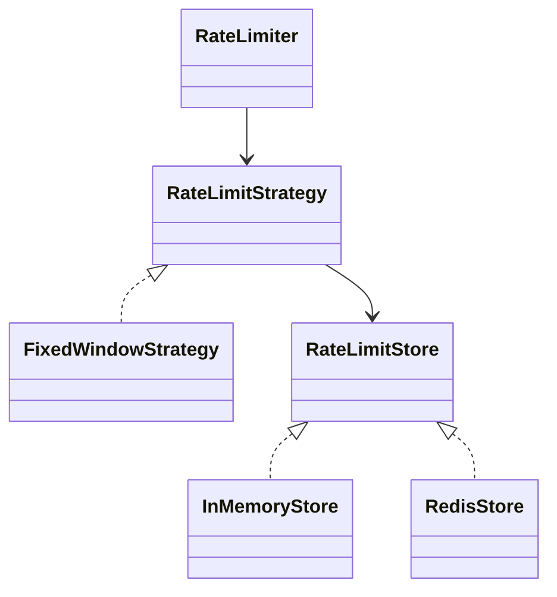

# Rate Limit — Engineering Guideline

TypeScript rate-limit library/service. This guideline MUST be followed for all code in this project.

The global guidelines (`~/.claude/CLAUDE.md`) still apply (pnpm, Simplicity First, Surgical Changes, Goal-Driven Execution).
Where this file is more specific, **this file wins**.

Core pillars:

1. **OOAD** — design before code
2. **SOLID** — every class and interface
3. **GoF design patterns** — applied where they remove real coupling or conditionals
4. **Env-var configuration** — via `.env`, validated with Zod
5. **Strict TypeScript** — zero type errors, no escape hatches

---

## 1. OOAD Workflow (MANDATORY before coding)

**No non-trivial feature may be implemented until its design is written down.**

```
1. Use cases        → who calls what, with which inputs/outputs
2. Domain model     → nouns = classes/interfaces, verbs = methods
3. Responsibilities → one reason to change per class (SRP)
4. Collaborations   → which abstractions talk to which (DIP)
5. Interfaces first → write the interfaces/types before any concrete class
6. Diagram          → Mermaid class diagram in docs/design/<feature>.md
7. Implement        → concrete classes against the interfaces
```

Design note template (`docs/design/<feature>.md`):

````markdown
# <Feature>

## Use cases
- <Actor> <does X> → <expected result>

## Classes & responsibilities
| Class / Interface | Responsibility | Collaborators |
|---|---|---|

## Patterns used
- <Pattern> — <why it is needed here>

## Diagram

````

A "trivial" change (rename, typo, single-line fix) does not need a design note.

---

## 2. SOLID Principles

### S — Single Responsibility

Each class has **one reason to change**. Algorithm, storage, key resolution, and configuration are separate classes.

```ts
// ❌ One class that parses config, talks to Redis, and computes windows
// ✅
class FixedWindowStrategy implements RateLimitStrategy { /* algorithm only */ }
class RedisStore implements RateLimitStore { /* storage only */ }
class IpKeyResolver implements KeyResolver { /* key extraction only */ }
```

### O — Open/Closed

Open for extension, closed for modification. Add a new algorithm by **adding a class**, never by editing a `switch`/`if` chain in existing code.

```ts
export interface RateLimitStrategy {
  consume(key: string, cost: number): Promise<RateLimitResult>;
}

// New algorithm = new file. No edits to RateLimiter.
export class TokenBucketStrategy implements RateLimitStrategy { /* ... */ }
```

The single place allowed to map config → concrete class is the factory (see §3).

### L — Liskov Substitution

Every implementation MUST honor its interface's full contract. Any `RateLimitStore` must be swappable without callers noticing:

- `increment` is atomic
- TTL semantics are identical (expiry in ms, set on first write)
- Errors are thrown as the same domain error types (`StoreUnavailableError`)

Never throw `NotImplementedError` from an interface method — that means the interface is wrong (see ISP).

### I — Interface Segregation

Prefer many small interfaces over one fat one. Clients depend only on what they use.

```ts
export interface Clock { now(): number; }
export interface KeyResolver<TRequest> { resolve(req: TRequest): string; }
export interface RateLimitStore {
  increment(key: string, ttlMs: number): Promise<number>;
  get(key: string): Promise<number | null>;
  reset(key: string): Promise<void>;
}
```

### D — Dependency Inversion

High-level modules depend on **abstractions**, injected via the **constructor**. Domain classes NEVER `new` concrete infrastructure or import `config` directly.

```ts
export class RateLimiter {
  constructor(
    private readonly strategy: RateLimitStrategy,
    private readonly keyResolver: KeyResolver<Request>,
  ) {}
}

// Wiring happens only in the composition root (src/index.ts or src/container.ts)
```

---

## 3. GoF Design Patterns

Use a pattern **only when it removes a real conditional or real coupling** — never speculatively (Simplicity First).
Name the pattern in the class name or a one-line doc comment so readers recognize it.

| Pattern | Category | Where in this project | Why |
|---|---|---|---|
| **Strategy** | Behavioral | `strategies/` — FixedWindow, SlidingWindow, TokenBucket, LeakyBucket | Swap algorithms without touching `RateLimiter` (OCP) |
| **Factory Method / Abstract Factory** | Creational | `factories/RateLimiterFactory` — builds strategy + store from config | Single place mapping config → concrete classes |
| **Adapter** | Structural | `stores/` — `InMemoryStore`, `RedisStore` wrap their clients behind `RateLimitStore` | Isolate third-party APIs |
| **Decorator** | Structural | `LoggingRateLimiter`, `MetricsRateLimiter` wrap a `RateLimiter` | Add cross-cutting concerns without modifying core |
| **Chain of Responsibility** | Behavioral | Composite rules (per-IP → per-user → global) | Evaluate multiple limits in order, short-circuit on reject |
| **Observer** | Behavioral | `onLimitExceeded` / `onReset` event listeners | Decouple alerting/metrics from limiting |
| **Builder** | Creational | Optional: `RateLimiterBuilder` for complex fluent setup | Only if constructor args exceed ~4 |
| **Singleton** | Creational | **Only** the validated `config` object (module-level export) | One source of truth for env config |

Rules:

- **NEVER** use a `static getInstance()` Singleton for services — inject them instead (testability, DIP).
- Factories are the **only** place allowed to contain a `switch` over algorithm/store type, and that `switch` MUST be exhaustive (see §6).
- Do not add a pattern "for future flexibility". Introduce it when the second implementation arrives.

---

## 4. OOP Conventions

- **Composition over inheritance.** Inheritance only for true is-a with shared behavior; max depth 1 (abstract base → concrete).
- **Encapsulation:** fields are `private readonly` by default. No public mutable fields. Expose behavior, not state.
- **Constructor injection** for all dependencies. No service locators, no hidden `import` of singletons in domain code.
- **One exported class per file**, file named after the class (`TokenBucketStrategy.ts`).
- **Naming:** no `I` prefix on interfaces (`RateLimitStore`, not `IRateLimitStore`). Implementations are prefixed by their variant (`RedisStore`, `InMemoryStore`).
- **Domain errors** extend a single `RateLimitError` base class; never throw strings or plain `Error` from domain code.
- **Immutability:** value objects (e.g. `RateLimitResult`) are `readonly` and created via constructor/factory.

### Folder Layout

```
src/
├── config/          # env.ts — the ONLY place that reads process.env
├── interfaces/      # RateLimitStrategy, RateLimitStore, KeyResolver, Clock
├── strategies/      # Strategy implementations
├── stores/          # Adapter implementations
├── factories/       # Factory classes (config → objects)
├── decorators/      # Decorator wrappers
├── errors/          # RateLimitError hierarchy
├── domain/          # RateLimiter, value objects
└── index.ts         # Composition root + public exports
docs/design/         # OOAD design notes
```

---

## 5. Environment Configuration (.env + Zod)

All runtime configuration comes from environment variables, loaded from `.env` and **validated with Zod at startup**.

### Rules

- **NEVER** read `process.env` outside `src/config/`. Everything else receives typed config via constructor injection.
- **NEVER** hardcode limits, windows, TTLs, URLs, hosts, ports, or secrets.
- `.env.example` is committed and documents **every** variable. `.env`, `.env.local`, `.env.*.local` are gitignored.
- Adding a variable = update the Zod schema **and** `.env.example` in the same change.
- Invalid or missing config **fails fast** at startup with a readable error listing every bad field.
- Tests build config objects directly — never mutate `process.env` in tests.

### `src/config/env.ts`

```ts
import 'dotenv/config';
import { z } from 'zod';

const EnvSchema = z
  .object({
    NODE_ENV: z.enum(['development', 'test', 'production']).default('development'),
    LOG_LEVEL: z.enum(['debug', 'info', 'warn', 'error']).default('info'),

    RATE_LIMIT_ALGORITHM: z
      .enum(['fixed-window', 'sliding-window', 'token-bucket', 'leaky-bucket'])
      .default('fixed-window'),
    RATE_LIMIT_MAX_REQUESTS: z.coerce.number().int().positive().default(100),
    RATE_LIMIT_WINDOW_MS: z.coerce.number().int().positive().default(60_000),

    RATE_LIMIT_STORE: z.enum(['memory', 'redis']).default('memory'),
    REDIS_URL: z.url().optional(),
  })
  .refine((env) => env.RATE_LIMIT_STORE !== 'redis' || env.REDIS_URL !== undefined, {
    error: 'REDIS_URL is required when RATE_LIMIT_STORE=redis',
    path: ['REDIS_URL'],
  });

export type Env = z.infer<typeof EnvSchema>;

// Pure + exported so tests can pass plain objects instead of mutating process.env
export function parseEnv(source: Readonly<Record<string, string | undefined>>): Readonly<Env> {
  const parsed = EnvSchema.safeParse(source);
  if (!parsed.success) {
    const issues = parsed.error.issues
      .map((i) => `  - ${i.path.join('.')}: ${i.message}`)
      .join('\n');
    throw new Error(`Invalid environment configuration:\n${issues}`);
  }
  return Object.freeze(parsed.data);
}

export const config: Readonly<Env> = parseEnv(process.env);
```

Zod is v4: use `z.url()` (not `z.string().url()`) and `{ error: ... }` (not `{ message: ... }`).

### `.env.example`

```dotenv
NODE_ENV=development
LOG_LEVEL=info

# fixed-window | sliding-window | token-bucket | leaky-bucket
RATE_LIMIT_ALGORITHM=fixed-window
RATE_LIMIT_MAX_REQUESTS=100
RATE_LIMIT_WINDOW_MS=60000

# memory | redis
RATE_LIMIT_STORE=memory
# Required when RATE_LIMIT_STORE=redis
REDIS_URL=redis://localhost:6379
```

---

## 6. TypeScript Type-Check Restrictions

`pnpm typecheck` (`tsc --noEmit`) MUST pass with **zero errors** before any task is considered done.

### Required `tsconfig.json` compiler options

```json
{
  "compilerOptions": {
    "target": "ES2022",
    "module": "NodeNext",
    "moduleResolution": "NodeNext",
    "types": ["node"],
    "strict": true,
    "noImplicitAny": true,
    "strictNullChecks": true,
    "noUncheckedIndexedAccess": true,
    "exactOptionalPropertyTypes": true,
    "noImplicitOverride": true,
    "noImplicitReturns": true,
    "noFallthroughCasesInSwitch": true,
    "noUnusedLocals": true,
    "noUnusedParameters": true,
    "useUnknownInCatchVariables": true,
    "forceConsistentCasingInFileNames": true,
    "verbatimModuleSyntax": true,
    "skipLibCheck": true,
    "noEmit": true
  },
  "include": ["src"]
}
```

These flags MUST NOT be weakened or disabled — not globally, not per file.

Toolchain: Node 24 (`.nvmrc`), ESM (`"type": "module"`, relative imports end in `.js`).
TypeScript is pinned to `~6.0` because `typescript-eslint` 8 does not support TS 7 yet. Do not upgrade until it does.

### Banned

| Banned | Use instead |
|---|---|
| `any` (explicit or implicit) | `unknown` + narrowing, generics, or a proper type |
| `as` type assertions | Type guards / Zod parsing. Allowed only at a validated boundary, with a comment |
| Non-null assertion `!` | Explicit null check or early return |
| `@ts-ignore`, `@ts-nocheck` | Fix the type. Last resort: `@ts-expect-error <reason>` |
| `enum` | `as const` object + union type |
| `Function`, `Object`, `{}` types | Precise function signatures / `Record<string, unknown>` |

### Required

- Explicit return types on all exported functions and public methods.
- `readonly` on properties and `ReadonlyArray<T>` / `readonly T[]` for inputs that are not mutated.
- External input (env, HTTP, JSON, Redis values) typed as `unknown` and narrowed through Zod.
- `import type` for type-only imports (enforced by `verbatimModuleSyntax`).
- Exhaustive `switch` over unions with a `never` check:

```ts
export const Algorithms = ['fixed-window', 'sliding-window', 'token-bucket', 'leaky-bucket'] as const;
export type Algorithm = (typeof Algorithms)[number];

function assertNever(value: never): never {
  throw new Error(`Unhandled case: ${String(value)}`);
}

// Only inside a factory (see §3)
switch (algorithm) {
  case 'fixed-window':   return new FixedWindowStrategy(store, opts);
  case 'sliding-window': return new SlidingWindowStrategy(store, opts);
  case 'token-bucket':   return new TokenBucketStrategy(store, opts);
  case 'leaky-bucket':   return new LeakyBucketStrategy(store, opts);
  default:               return assertNever(algorithm);
}
```

### ESLint

- Extend `@typescript-eslint/strict-type-checked` and `@typescript-eslint/stylistic-type-checked`.
- `@typescript-eslint/no-explicit-any: error`
- `@typescript-eslint/explicit-function-return-type: error`
- `@typescript-eslint/switch-exhaustiveness-check: error`
- `no-restricted-properties` forbids `process.env` outside `src/config/`.
- `no-restricted-syntax` forbids `enum` declarations.

### Scripts (`package.json`)

```json
{
  "scripts": {
    "typecheck": "tsc --noEmit",
    "lint": "eslint .",
    "test": "vitest run",
    "check": "pnpm typecheck && pnpm lint && pnpm test"
  }
}
```

---

## 7. Definition of Done

A task is complete only when every item holds:

- [ ] Design note exists in `docs/design/` (non-trivial features)
- [ ] Each new class has a single responsibility; dependencies are injected interfaces
- [ ] Any GoF pattern used is named and justified in the design note
- [ ] No `process.env` access outside `src/config/`; no hardcoded config values
- [ ] Zod schema and `.env.example` updated for any new variable
- [ ] No `any`, `as` (outside validated boundaries), `!`, `@ts-ignore`, or `enum`
- [ ] `pnpm check` passes (typecheck + lint + test), with output shown as evidence
